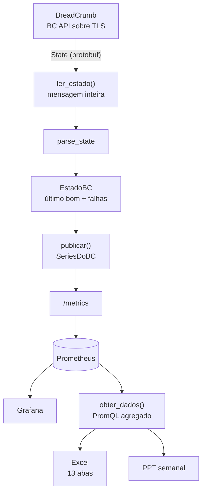
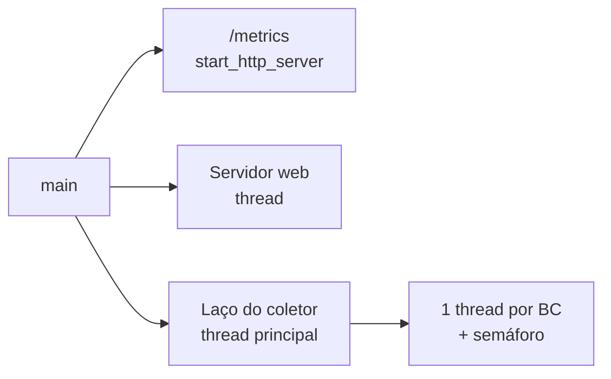

# Arquitetura

Como o `rajant_monitor.py` funciona por dentro: o caminho que um dado
percorre do rádio até o gráfico e o slide, cada peça, e por que ela está onde
está.

Para *usar* o programa, leia o [README](README.md). Este documento é para
quem vai **mexer** nele.

---

## Índice

1. [O que é](#1-o-que-é)
2. [Decisões estruturantes](#2-decisões-estruturantes)
3. [O caminho do dado](#3-o-caminho-do-dado)
4. [Transporte e parsing](#4-transporte-e-parsing)
5. [Estado e confiabilidade](#5-estado-e-confiabilidade)
6. [Séries no /metrics](#6-séries-no-metrics)
7. [Descoberta, coleta e tag](#7-descoberta-coleta-e-tag)
8. [As 101 métricas](#8-as-101-métricas)
9. [Modelo de execução](#9-modelo-de-execução)
10. [Modo serviço](#10-modo-serviço)
11. [Relatório Excel](#11-relatório-excel)
12. [Relatório PowerPoint](#12-relatório-powerpoint)
13. [Identidade Anglo](#13-identidade-anglo)
14. [Página web e endpoints](#14-página-web-e-endpoints)
15. [Grafana e painel próprio](#15-grafana-e-painel-próprio)
16. [Configuração completa](#16-configuração-completa)
17. [Linha de comando](#17-linha-de-comando)
18. [Testes](#18-testes)
19. [Build e distribuição](#19-build-e-distribuição)
20. [As invariantes](#20-as-invariantes)
21. [Limites conhecidos](#21-limites-conhecidos)
22. [Solução de problemas](#22-solução-de-problemas)
23. [Mapa do arquivo](#23-mapa-do-arquivo)
24. [Glossário](#24-glossário)

---

## 1. O que é

Um processo que faz duas coisas sobre a mesma coleta, numa malha Rajant
BreadCrumb de ~150 nós em mina a céu aberto:

| papel | saída |
|---|---|
| **Exportador Prometheus** | 101 famílias de métrica em `/metrics` |
| **Gerador do relatório semanal** | Excel (13 abas) e PowerPoint |

E um supervisor (`servico_rajant.py`) que sobe exportador, Prometheus e
Grafana em segundo plano e os reergue se caírem.

O site survey (captura ao vivo, leitura do MeshMapper, KMZ, deck próprio)
foi descontinuado e saiu do código; está no histórico do git.

### Números do código

| | |
|---|---|
| linhas | ~5300 (`rajant_monitor.py`) + ~740 (`servico_rajant.py`) |
| funções no topo | 101 |
| classes | 6 |
| famílias de métrica | 101 |
| endpoints HTTP | 5 |
| testes | 189, em 31 classes |
| comentários | ~13% das linhas |

Os comentários quase todos registram uma armadilha concreta. A convenção é
rígida — **comentário explica *por que*, não *o quê***. Um comentário que
registra o bug evitado é o que impede a próxima pessoa de "simplificar" de
volta.

---

## 2. Decisões estruturantes

### Por que um arquivo só

A rede da mina é isolada: sem PyPI, sem Docker, sem pipeline de deploy. O
que roda lá chega por pendrive ou cópia de arquivo. Um pacote com
`__init__.py`, dependências internas e ordem de importação é mais uma coisa
para dar errado no lugar onde ninguém pode depurar. O supervisor é o único
módulo à parte, porque não tem nada a ver com rádio.

### Dependências

| pacote | para quê | crítico? |
|---|---|---|
| `rajant-api` | falar com os BCs | sim |
| `protobuf 4.23.4` | a `rajant-api` depende | sim |
| `prometheus_client` | expor `/metrics` | sim |
| `python-pptx` | gerar o deck semanal | só relatório |
| `openpyxl` | gerar o Excel | só relatório |
| `lxml` | XML do PPTX | via python-pptx |

**Nada de framework web.** O servidor é `http.server` da biblioteca padrão
e a página é HTML/CSS/JS embutido no próprio arquivo. Rede isolada não baixa
bundle nem CDN.

### A armadilha da rajant-api

Ela declara três dependências e **só usa uma** (`protobuf`); `grpcio 1.56.2`
não tem wheel para Python 3.12+. Por isso `pip install rajant-api --no-deps`
e o protobuf à parte.

E ela faz `from ssl import wrap_socket`, função **removida no Python 3.12**.
O módulo instala um *shim* compatível antes de importá-la: `import
rajant_api` sozinho falha, `import rajant_monitor` funciona. O shim reproduz
o comportamento antigo **inclusive sem validar certificado**, que é o que os
BCs exigem, por usarem certificado autoassinado.

---

## 3. O caminho do dado



Um caminho só de leitura do rádio: o **coletor**, em ciclo fixo. Os
relatórios não falam com rádio nenhum; leem o Prometheus.

---

## 4. Transporte e parsing

### A sessão com o rádio

Por BC e por ciclo: `reachable()` → `autenticar()` → `ler_estado()` →
`fechar_sessao()`. Três coisas da biblioteca foram contornadas, todas lidas
no código da 0.1.1:

**`get_state()` lê com um único `recv(65535)`.** Pelo TLS um `recv` traz no
máximo um registro (~16 KB), e o State de rádio com muitos vizinhos passa
disso. Ela então devolve `False` — e esse `False` atravessava `parse_state()`
como um State vazio: sem nome, sem rádio, sem vizinho, **contado como
leitura boa**. Com o filtro de tag ligado, o rádio grande saía do Grafana
como "sem tag".

`ler_estado()` faz o mesmo pedido (`state.Clear()`) pela sessão autenticada
dela e lê com `bc_receber()`, que segue o enquadramento do código da
biblioteca — cabeçalho `>ibbbb` (tamanho, compressão 2 = deflate cru,
`wbits -15`) — e lê **até o tamanho que o cabeçalho declara**. Objeto que não
é sessão da biblioteca (teste, outra versão) passa pelo `get_state()`, e
`False`/vazio vira `ConnectionError`: State que não veio é **falha de
coleta**, conta para o offline, e nunca vira State vazio.

**`authenticate()` devolve `False` para tudo.** `autenticar()` faz os mesmos
passos (o rádio manda um desafio; volta sha384 da senha + desafio) e levanta
a exceção com o motivo: usuário que não existe na BCAPI (antes de ir à
rede), senha recusada com a descrição do rádio e o aviso de espaço no começo
ou no fim, e a etapa em que parou (conexão TLS, desafio, resultado). O papel
vai em maiúsculo — a biblioteca faz `roles[role]` num dicionário que só tem
`CO`, e com `co` o `KeyError` era engolido. Se o caminho daqui falhar por
rede, tenta o `authenticate()` dela antes de desistir e registra no log.
O login se identifica como `rajant_monitor` (`auth.userAgent`), que o rádio
mostra em `State.adminSessions`.

**A `Breadcrumb` não tem `close()`.** `fechar_sessao()` fecha o socket logo
depois da leitura, em vez de deixar a sessão aberta no rádio até o coletor de
lixo passar.

O ping de alcance que o `get_state()` fazia antes de cada consulta saiu: a
coleta já chamou `reachable()`.

### extrair_blocos() conta chaves

`parse_state()` recebe o State em **texto de protobuf** e extrai por regex —
com um detalhe que não é opcional: regex não equilibra `{}`, e os blocos
aninham (um `peer` dentro de `wireless`). `extrair_blocos()` percorre
contando profundidade.

> `parse_state()` é a fronteira. Dali para dentro tudo é dicionário Python;
> nenhuma outra parte do programa sabe que existe protobuf.

A subárvore `configuration` repete nomes de mensagens do estado (`wired`,
`wireless`, `battery`...) e é retirada antes da extração; dela só saem nome
e grupos.

### Conversões que estavam erradas

| campo | erro | correto |
|---|---|---|
| **GPS** | tratado como grau decimal | é **NMEA** (`ggmm.mmmm`) — `nmea_para_graus()` |
| **SNR** | `rssi - abs(ruido)`, sempre negativo | derivado de sinal e ruído |
| **temperatura** | divisor fixo | centésimos ou grau, pela magnitude |

### Ping

`ping_rtt(ip)` faz um ICMP por BC por ciclo, para `ping_rtt_ms` e `ping_ok`.
Latência e perda só existem porque **a BC API não as fornece**.

---

## 5. Estado e confiabilidade

### EstadoBC

Último dado bom, hora da última coleta boa (epoch) e falhas consecutivas. Um
BC **não fica offline no primeiro timeout** — a malha tem perda, e sem isso
o painel piscaria a cada varredura. `falhas_antes_offline` define quantas
falhas seguidas derrubam.

### JanelaDisponibilidade

Deque de `(timestamp, online)` com janelas deslizantes de 1 h, 24 h e 7 d
(metodologia BCE): operação, turno e relatório.

### CacheIPs

IPs e nomes já vistos, persistidos em disco. Existe para sobreviver a
reinício com o seed fora do ar. Ressuscita endereço que saiu da rede, e por
isso pode ser desligado (`[coleta] usar_cache = false`).

---

## 6. Séries no /metrics

O `prometheus_client` guarda o último valor de cada combinação de rótulos
**para sempre**, até alguém chamar `.remove()`. Era a linha reta do Grafana:
rádio que parou de responder e vizinho que saiu da tabela de peers seguiam
no `/metrics` com a última leitura, e o Prometheus raspava o mesmo número
indefinidamente.

`SeriesDoBC` anota tudo o que `publicar()` gravou para um IP nesta coleta.
No fim, `fechar()` remove o que existia na coleta anterior e não foi gravado
agora:

- vizinho que sumiu da tabela → saem as séries daquele enlace;
- campo que veio `None` → a série sai (não fica o valor antigo);
- BC que não respondeu → `marcar_offline()` grava só `rajant_online = 0`,
  falhas, última coleta e disponibilidade; `rajant_bc_info` (modelo,
  firmware) fica; as medições saem.

O Prometheus encerra a série (staleness) e o Grafana desenha o buraco. Os
painéis usam `spanNulls` de 3 min: uma raspagem perdida não quebra a linha,
buraco maior aparece.

`segurar_serie_s` > 0 mantém as séries de um BC que falhou por esse tempo
(com a última leitura), para quem prefere a linha contínua num rádio que
perde uma coleta ou outra. O padrão é 0.

`retirar_series(ip)` tira tudo de um IP — usado quando ele passa a não ter
tag (renomeado) ou nunca deu nome.

`rajant_ultima_coleta_ts` é epoch da última coleta **boa**; era um relógio
monotônico, que não diz hora nenhuma e não serve para `time() - x`.

---

## 7. Descoberta, coleta e tag

O `RajantCollector` parte dos *seeds* e caminha pelos peers, em lotes. Cada
ciclo dispara uma thread por BC, limitadas por semáforo (`max_threads`).

### Nó físico ≠ IP

Um BC com quatro rádios responde em quatro IPs. `_publicar_identidade()`
agrupa por identidade reportada, nesta ordem de confiabilidade:

1. `system.ipv4` — o IP que o próprio BC reporta, único por nó
2. o nome configurado
3. o IP consultado (nó ainda não identificado)

O IP reportado vem **primeiro** porque nome repetido na rede (config
duplicada) colapsaria nós distintos. Grupo com mais de `MAX_IFACES = 6`
interfaces sugere colisão de nome e é desagrupado. Interface que deixou de
ser vista sai de `rajant_bc_primario`/`rajant_bc_interfaces`.

### Lista fechada é fechada

Com `descoberta = false`, o ciclo **não** reintroduz peers pela porta dos
fundos. Seed que não responde **continua na lista**.

### Coleta acelerada dos móveis

`intervalo_moveis_segundos` roda um ciclo curto só com os equipamentos que
casam com `[relatorio] padrao_movel`. Veículo muda de posição e de vizinho o
tempo todo; torre, não.

### Só equipamento com tag

`filtrar_tag = true` (padrão) só publica nome que casa com `padrao_tag`
(`^[A-Z]{2,5}[- ]?\d{2,}`, sem diferenciar maiúsculas): CA-1035, ERM-22 PTP
CAM, RED065, PCP-002. As 155 entradas nomeadas de `REDE_CONHECIDA` casam; IP
não casa.

- **O nome** vem de `nome_conhecido(ip)`: o que o rádio informou nesta
  execução, depois o cache, depois `REDE_CONHECIDA`. IP sem nome por nenhum
  dos três não entra no `/metrics` nem como offline — era o `10.188.99.217`
  do Grafana.
- **O vizinho** é resolvido por `nome_vizinho(peer)`: pelo IP, ou, quando o
  peer só traz MAC, pelo `encapId`, que é o sufixo do número de série do
  vizinho (`nome_encap`, montado com o serial de cada BC coletado; conferido
  em 35 vizinhos de uma captura de campo). Vizinho sem tag não vira série, e
  o rótulo `peer` passa a ser a **tag**.
- **O descarte é auditável**: log `ignorado: nome sem tag` e
  `rajant_bc_sem_tag`. O sem tag volta a ser consultado só na redescoberta (o
  nome pode ter mudado).

---

## 8. As 101 métricas

Prefixo `rajant_`. Agrupadas como aparecem no código:

### Descoberta (4)
`cache_total` · `cache_online` · `seed_status` · `bc_sem_tag`

### Sistema (16)
`online` · `uptime_s` · `temperatura_c` · `temperatura_classe` ·
`bateria_pct` · `bateria_ma` · `bateria_carregando` · `bateria_temp_c` ·
`bateria_autonomia_min` · `bateria_recarga_min` · `boot_counter` ·
`reboot_needed` · `memoria_livre_kb` · `cpu_load_pct` · `bridge_ativa` ·
`apt_master`

### Disponibilidade (5)
`disponibilidade_1h_pct` · `disponibilidade_24h_pct` ·
`disponibilidade_7d_pct` · `falhas_consecutivas` · `ultima_coleta_ts`

### Rádio (24)
`radio_canal` · `radio_ruido_dbm` · `radio_ruido_classe` ·
`radio_txpower_dbm` · `radio_rx_bytes` · `radio_tx_bytes` ·
`radio_rx_pacotes` · `radio_tx_pacotes` · `radio_rx_mbps` ·
`radio_tx_mbps` · `radio_rx_pps` · `radio_tx_pps` · `radio_ch_active_ms` ·
`radio_ch_busy_ms` · `radio_ch_rx_ms` · `radio_ch_tx_ms` ·
`radio_busy_pct` · `radio_rx_pct` · `radio_tx_pct` · `radio_idle_pct` ·
`radio_interf_pct` · `radio_peers_ativos` · `radio_peers_total` ·
`radio_clientes`

### Peers (8) + good peers (1)
`peer_snr_db` · `peer_sinal_dbm` · `peer_rssi` · `peer_taxa_mbps` ·
`peer_custo` · `peer_ativo` · `first_hop_cost` · `bc_info` ·
`radio_good_peers` (peers com SNR > 30 dB, critério BCE)

### GPS e identidade (11)
`gps_lat` · `gps_lon` · `gps_fix` · `gps_vel_kmh` · `gps_rumo_graus` ·
`gps_satelites` · `gps_altitude_m` · `gps_precisao_h` · `bc_primario` ·
`bc_interfaces` · `nos_fisicos_total`

### Ping e topologia (3) + score (1)
`ping_rtt_ms` · `ping_ok` · `link_changes` · `mesh_score` (0–100)

### InstaMesh (7 + 8 substitutas)
`im_pkt_tx` · `im_pkt_rx` · `im_pkt_drop` · `im_floods_drop` ·
`im_arp_total` · `im_disc_sourced` · `im_disc_passed` ·
`im_source_floods_drop` · `im_pkt_multicast` · `im_tx_pps` · `im_rx_pps` ·
`im_drop_pps` · `im_perda_pct` · `im_floods_pps` · `im_arp_pps`

### Ethernet e alertas (12)
`eth_link` · `eth_apt_state` · `eth_rx_bytes` · `eth_tx_bytes` ·
`eth_rx_pacotes` · `eth_tx_pacotes` · `eth_rx_mbps` · `eth_tx_mbps` ·
`eth_peers` · `ap_clientes` · `best_radio_rate` · `alertas_ativos`

### A interferência é derivada, não medida

**A BC API não expõe varredura de espectro.** Verificado nos 13 arquivos
`.proto`, e há teste que **falha se algum passar a expor**.
`radio_interf_pct` vem dos contadores de *airtime* (`busy − rx − tx`),
calculada **só sobre delta** entre leituras — os contadores são cumulativos
desde o boot. Não é analisador de espectro.

---

## 9. Modelo de execução



Tudo é *thread*, nada é `async`. A carga é I/O de rede com timeout.

**O teto de threads não é sobre o servidor.** 150 conexões simultâneas
derrubam a malha antes de derrubar o processo. O gargalo protegido é o
rádio.

### Sequência de subida

1. ações de serviço (`--servico`, `--status`...) saem antes do argparse;
   no `.exe`, a pasta de trabalho vira a do executável
2. lê config, resolve seeds, valida `padrao_tag`, avisa chave antiga
3. `CacheIPs` (ou desligado)
4. `start_http_server(metrics_port)` — o `/metrics`
5. servidor de relatórios em thread (salvo `--sem-relatorios`)
6. banner no log com seeds, descoberta, cache, tag, séries, portas
7. laço: descoberta → ciclo → espera

---

## 10. Modo serviço

`servico_rajant.py`, chamado por `rajant_monitor.exe --servico`.

### A tarefa do Windows

`--instalar-servico` (pelo `instalar_inicializacao.bat`, como admin) cria a
tarefa **Rajant Monitor** por **XML**, não pelas opções do `schtasks`: tarefa
criada pela linha de comando vem com "parar se rodar mais de 3 dias", e o
supervisor seria derrubado na quinta-feira. O XML põe:

| | |
|---|---|
| gatilho | `BootTrigger` — na inicialização, sem ninguém logado |
| usuário | `S-1-5-18` (SYSTEM), privilégio mais alto |
| limite de execução | `PT0S` — nenhum |
| se falhar | reinicia a cada 1 min |
| bateria | não para nem deixa de iniciar |

Como SYSTEM a pasta corrente é `C:\Windows\System32`; por isso o `main()`
faz `chdir` para a pasta do `.exe` antes de tudo.

### Sem administrador: o login do usuário

`--instalar-usuario` (pelo `instalar_inicializacao_usuario.bat`) grava o
valor **Rajant Monitor** em `HKCU\Software\Microsoft\Windows\CurrentVersion\Run`
(`winreg`, sem ferramenta externa): o Windows roda o comando no login daquele
usuário, e a chave é dele — não pede administrador. O valor é
`linha_de_inicio()`, o `.exe` entre aspas (a pasta pode ter espaço) com
`--iniciar`.

`--iniciar` abre `--servico` com o mesmo `_abrir_oculto()` dos filhos e
volta na hora: a janela do `.exe` de console pisca e fecha, o supervisor fica
num console escondido. Se o `servico.pid` aponta para um supervisor vivo, não
abre outro.

Antes de gravar, `pasta_gravavel()` confere a pasta do `.exe` **criando um
arquivo de verdade**: `os.access` no Windows só olha o atributo
somente-leitura, e `Program Files` sem administrador passa nele e falha na
hora de gravar — o supervisor morreria calado num console escondido. A mesma
conferência vira aviso para as pastas `data\` do Prometheus e do Grafana, que
os dois gravam dentro da própria instalação.

Limites, que não têm contorno sem administrador: só roda depois do login, e
o logoff encerra tudo. `--status` diz o que está configurado (tarefa, login
ou nenhum) e avisa se o valor do login aponta para outra pasta — o monitor
copiado para outro lugar, com o login ainda abrindo a versão antiga.

### O supervisor

`rodar()`: instância única (pelo `servico.pid`), grava o pid **antes** da
espera inicial (nesses 20 s um segundo `--iniciar` abriria outro supervisor,
e o `--parar` não acharia nada), espera `espera_inicial_s`, monta os
serviços e confere a cada 5 s.

`Servico.verificar()`:

- processo vivo → nada;
- porta já atendida por outro processo → **externo**: não sobe outro
  (Grafana instalado como serviço do Windows, Prometheus aberto à mão); se
  aquele cair, passa a cuidar;
- caiu → reergue, com espera 5, 10, 30, 60 s entre tentativas seguidas.

**Oculto, mas com console.** Os filhos sobem com `CREATE_NEW_CONSOLE` e
`STARTUPINFO` em `SW_HIDE` — o que um `WshShell.Run cmd, 0` faz. Com
`CREATE_NO_WINDOW` o filho fica sem console, e cada `ping` que o exportador
dispara abriria uma janela.

O exportador recebe `RAJANT_SERVICO=1` e deixa de escrever no console (o
log em arquivo continua). A saída de Prometheus e Grafana vai para
`logs\`, e recomeça ao passar de 20 MB.

`--parar` mata supervisor e filhos (`taskkill /T /F`, a árvore inteira);
nunca o próprio processo nem o próprio grupo.

### Onde estão os programas

`[servicos] prometheus_exe` e `grafana_exe`; vazio = procurar em
`raizes_de_instalacao()` (pasta do monitor, a de cima, `C:\`, `D:\`,
`Program Files`). O Grafana roda com `--homepath` na raiz da instalação (a
pasta acima de `bin\`); `grafana.exe` novo recebe `server`. O Prometheus roda
na própria pasta, então `--config.file=prometheus.yml` é o de lá.

---

## 11. Relatório Excel

Treze abas, geradas com `openpyxl` a partir da mesma estrutura que alimenta
o PPT:

| aba | conteúdo |
|---|---|
| Resumo Executivo | KPIs do período contra as metas |
| Disponibilidade | por BC, nas três janelas |
| Série Diária | evolução no período |
| Throughput | vazão por BC e agregada |
| Canais & RF | canal, potência, ruído |
| Espectro por Canal | ocupação e ruído agregados |
| Links (Peers) | enlaces com SNR, taxa, custo |
| Ethernet | portas, link, APT, tráfego |
| Saúde BreadCrumbs | CPU, memória, temperatura, bateria |
| Rankings | top tráfego, top vizinhos |
| Categorias | por tipo de equipamento |
| Eventos | quedas, com início/fim/duração |
| Inventário | todos os BCs, com identificação |

Os dois formatos leem **a mesma** estrutura de `obter_dados()`. Divergir
aqui produziria um Excel e um PPT que discordam sobre a mesma semana.

---

## 12. Relatório PowerPoint

O semanal parte do template do cliente (`Relatorio_Semanal_Rede.pptx`).
Preenchido por âncoras, não por índice: `_slide_por_titulo()` localiza pelo
texto do título, com índice como *fallback*. Tabelas por cabeçalho
(`_tabela_por_cabecalho`), cartões por rótulo (`_txt_valor_do_cartao`).

Quatro slides são **gerados por código** e inseridos no lugar certo:

1. `4. Saúde da Mesh Rajant — Evolução Diária` (2 gráficos nativos)
2. `4. Saúde da Mesh Rajant — Links Críticos (SNR)` (10 piores enlaces)
3. `4. Saúde da Mesh Rajant — Ethernet e Quedas`
4. `4. Saúde da Mesh Rajant — Espectro por Canal` (gráfico + tabela)

Os gráficos são **nativos do PowerPoint** (`CategoryChartData`), não
imagens: quem receber o deck pode editar.

### A seção de survey do template

O template ainda traz a seção *5. Site Survey*. `remover_slides_survey()`
tira esses slides, senão ficariam em branco, e o botão do menu vira *"5. Site
Survey (descontinuado)"* sem link.

O que decide é o **título**, não o texto do slide: o subtítulo de *Links
Críticos* diz "candidatos a realinhamento / site survey", e casar o texto
levava o slide junto. `_titulo_do_slide()` pega a caixa de texto mais alta
**que não é botão** — o ◂ MENU fica em 0,28" e o título em 0,32". Remove de
trás para frente (pelo índice crescente, bagunçaria os seguintes) e solta a
parte (`drop_rel`), senão o arquivo carregaria o slide órfão.

### Navegação

**Um botão do template carrega DOIS hyperlinks** — um na forma e outro
dentro do *run*. Clicando no texto, o PowerPoint usa o do run, que o
python-pptx não expõe. `_limpar_link_de_texto()` remove o `hlinkClick` do
`rPr`.

---

## 13. Identidade Anglo

```python
azul   = 031795   # institucional: título, régua, fundo da capa
azul2  = 19328F   # preenchimento secundário
texto  = 1A1A1A
suave  = 5A6478
linha  = D6DAE3
fundo  = FFFFFF
cartao = F4F6FA
fonte  = Calibri
```

Extraída do arquivo do cliente. Os logos ficam em `marca/`; sem a pasta o
deck sai **sem logo**, em vez de estourar.

`aplicar_identidade_anglo()` repinta o deck **no fim da geração**, depois de
preenchido. Assim a passagem pega também o verde/âmbar/vermelho que o
relatório acabou de escrever e os slides técnicos gerados por código.

Isso só é seguro porque o template não deixa nada para herdar: **874 runs de
texto e todos com cor explícita**, master e layout sem forma nenhuma, fonte
já Calibri.

**Branco depende do que ficou atrás.** Na capa o fundo vira azul e o título
segue branco; sobre um cartão que clareou, o mesmo branco tem de virar
escuro. A decisão é por **luminância do fundo novo**.

**Borda de célula não passa pelo python-pptx.** Ela mora em
`lnL/lnR/lnT/lnB` dentro do `tcPr`. Sem tratá-la no XML sobravam **1248
traços** azul-escuros riscando o fundo branco.

---

## 14. Página web e endpoints

Duas portas: `porta_metrics` (`/metrics`, para o Prometheus) e
`porta_relatorio` (a página).

| endpoint | o que faz |
|---|---|
| `/` | período (7 / 30 dias ou datas), Excel ou PPT, link do painel, diagnóstico por IP |
| `/gerar?ini=&fim=&fmt=xlsx\|pptx[&demo=1]` | gera e baixa; até 366 dias |
| `/painel` | o painel HTML próprio, lido do disco a cada pedido |
| `/api/q?q=[&t=range&janela=&passo=]` | proxy PromQL para o painel (sem CORS); janela ≤ 90 d, passo 15 s–1 h |
| `/diagnostico?ip=` | lê o State de um BC e mostra portas ethernet e o trecho bruto |

Só `GET` (outro método: 501). Rota desconhecida: 404.

---

## 15. Grafana e painel próprio

### Seis dashboards

| arquivo | título | painéis |
|---|---|---|
| `rajant-visao-geral.json` | 1 · Visão Geral da Malha | 17 |
| `rajant-rf.json` | 2 · Rádio e Espectro | 22 |
| `rajant-enlaces.json` | 3 · Enlaces da Malha | 14 |
| `rajant-ethernet.json` | 4 · Portas Ethernet | 14 |
| `rajant-saude.json` | 5 · Saúde dos BreadCrumbs | 27 |
| `rajant-coletor.json` | 6 · Operação do Coletor | 15 |

São **gerados** por `gerar_dashboards.py` e conferidos por
`validar_dashboards.py` — o validador checa que toda métrica referenciada
existe no exportador. `provisioning-dashboards.yaml` põe os seis no Grafana
sem clique.

### Painel HTML próprio

`painel/visao-geral.html` — dashboard sem dependência externa, servido em
`/painel`. Zero CDN, zero build.

---

## 16. Configuração completa

`config.ini` é criado no primeiro uso com os padrões comentados; as seções
`[relatorio]` e `[servicos]` entram sozinhas quando faltam.

### `[rede]`

| chave | o que faz |
|---|---|
| `seeds` | IPs de partida (vírgula) |
| `password` / `role` | credenciais da BCAPI; `role` em qualquer caixa |
| `porta_bcapi` | 2300 |

### `[coleta]`

| chave | padrão | o que faz |
|---|---|---|
| `intervalo_segundos` | 60 | ciclo |
| `max_threads` | 30 | consultas simultâneas |
| `timeout_conexao` | 15 | por BC |
| `tentativas_por_bc` | 3 | antes de contar falha |
| `falhas_antes_offline` | 3 | falhas seguidas para `online = 0` |
| `segurar_serie_s` | 0 | segundos que as séries de um BC que falhou ficam |
| `redescoberta_ciclos` | 10 | a cada quantos ciclos redescobre |
| `falhas_para_remover` | 20 | tira do cache após N falhas |
| `descoberta` | true | `false` = só os seeds |
| `usar_cache` | true | `false` = não lê nem escreve o cache |
| `filtrar_tag` | true | só equipamento com tag |
| `padrao_tag` | `^[A-Z]{2,5}[- ]?\d{2,}` | o formato da tag |
| `intervalo_moveis_segundos` | 20 | ciclo curto dos móveis; 0 = desliga |

Chaves antigas ignoradas, com aviso no log: `manter_ultimo_valor_s`,
`somente_com_tag`.

### `[relatorio]` — 16 chaves

| chave | o que faz |
|---|---|
| `prometheus_url` | de onde vêm os dados dos relatórios |
| `porta_relatorio` | porta da página web |
| `meta_geral` / `meta_mesh` / `meta_backbone` | metas de disponibilidade |
| `limite_cpu` / `limite_temp` / `limite_latencia` / `limite_ruido` | limiares |
| `padrao_erb` / `padrao_erm` / `padrao_backbone` / `padrao_movel` | regex de classificação |
| `template_ppt` | o template do semanal |
| `painel_html` | caminho do painel próprio |
| `identidade_anglo` | `false` mantém o visual original do template |

### `[servicos]`

| chave | padrão | o que faz |
|---|---|---|
| `prometheus_exe` / `grafana_exe` | (procurar) | caminhos |
| `prometheus_args` | `--config.file=prometheus.yml` | |
| `prometheus_porta` / `grafana_porta` | 9090 / 3000 | para saber se está de pé |
| `iniciar_prometheus` / `iniciar_grafana` / `iniciar_exportador` | true | `false` = o supervisor não mexe |
| `espera_inicial_s` | 20 | ao ligar a máquina |

### `[servidor]` e `[log]`

`porta_metrics` (8000); `arquivo` e `nivel` do log (gira em 10 MB × 5).

---

## 17. Linha de comando

| flag | o que faz |
|---|---|
| (nenhuma) | exportador + página web |
| `--servico` / `--iniciar` / `--status` / `--parar` | supervisor (§10) |
| `--instalar-usuario` / `--remover-usuario` | sobe no login, sem administrador |
| `--instalar-servico` / `--remover-servico` | a tarefa do Windows (administrador) |
| `--seed` / `--role` / `--password` / `--port` | rede e credenciais |
| `--interval` / `--metrics-port` / `--porta-relatorio` | ciclo e portas |
| `--sem-relatorios` | sobe só o exporter |
| `--debug` | log verboso |
| `--dump-state IP` | salva o State bruto e sai |
| `--diagnostico-eth IP` | foca na porta ethernet: blocos, campos e valores |
| `--gerar-relatorio INI FIM` | gera o Excel e sai |
| `--demo` | dados sintéticos (carimbados como tal) |

---

## 18. Testes

`teste_parser.py`: **189 testes em 31 classes**, rodando **sem rádio e sem a
`rajant_api`** (há um stub no topo). Com a biblioteca instalada, roda também
os testes do protocolo real contra um rádio simulado; sem ela, esses são
pulados.

| área | classes |
|---|---|
| parser | `TestBlocoConfiguration`, `TestCamposInexistentes`, `TestInstaMesh`, `TestAPT`, `TestClientesAP`, `TestPeers`, `TestGPS`, `TestSistema`, `TestRadio`, `TestCamposDescartados`, `TestGpsTimeParaSegundos` |
| publicação e séries | `TestPublicar`, `TestCPUDerivada`, `TestRobustez`, `TestSeriesNoMetrics`, `TestInterferencia` |
| coleta e tag | `TestIntervaloMoveis`, `TestDescobertaEFiltro`, `TestIdentidadeDoVizinho`, `TestLeituraDoEstado` |
| protocolo | `TestLoginBCAPI` (rádio falso que fala o login e o State reais, em pedaços como pelo TLS), `TestShimSslWrapSocket` |
| modo serviço | `TestServicoSegundoPlano` (Prometheus e Grafana falsos, porta já atendida, pid, tarefa XML) |
| relatório | `TestSemanalSemSurvey`, `TestTituloDoSlide`, `TestRemocaoDaSecaoDeSurvey`, `TestSlidesTecnicosNoSemanal`, `TestIdentidadeAnglo`, `TestIdentidadeNoSemanal` |
| web | `TestPaginaSoRelatorios` (servidor de verdade numa porta livre), `TestPainelHTML` |

### Teste que passa com o bug reintroduzido não é teste

Vale rodar a mutação antes de confiar num teste novo. Os desta rodada
foram conferidos assim: sem `fechar()`, offline sem remoção, vizinho sem
filtro de tag, `ultima_coleta` monotônica, `get_state()` no lugar de
`ler_estado()` — cada um derruba pelo menos um teste. E
`test_a_biblioteca_sozinha_perde_o_state_grande` prova, com o mesmo rádio
falso, que a leitura da biblioteca devolve `False` onde `ler_estado()` lê
tudo.

---

## 19. Build e distribuição

`build/gerar_exe.bat` gera `rajant_monitor.exe` no Windows, em cinco passos
com log completo em `build/log_build.txt`, e copia para `dist\rajant_monitor\`
o que é editável sem recompilar: `painel/`, `marca/`, o template, o
`config.ini` e os arquivos de `build\windows\` (instalar/remover a
inicialização, parar tudo, iniciar oculto, `prometheus_exemplo.yml`).

Decisões que custaram:

**`python -m PyInstaller`, não `pyinstaller`.** Quando o pip cai em "user
installation", os executáveis vão para uma pasta `Scripts` fora do PATH.

**`--no-deps` em linha separada.** Juntar com o passo anterior faria o
`--no-deps` valer para o comando inteiro.

**A conferência importa `rajant_monitor`, não `rajant_api`** (§2).

**`servico_rajant` em `hiddenimports`.** Ele é importado dentro do
`main()`; sem a declaração o PyInstaller não o leva.

**A janela do build não fecha sozinha, nem no erro.**

> **Sem compilação cruzada:** `.exe` de Windows só sai de máquina Windows.

`build/diagnostico.bat` e `diagnostico.py` coletam ambiente, versões e o
resultado dos imports para diagnóstico remoto.

---

## 20. As invariantes

### 1. Nunca publicar 0 no lugar de "não medi"

Zero é indistinguível de "medido e deu zero". Campo sem medição vira `None`
e a série é **omitida**. Era o que fazia contador de erro de ethernet e CPU
parecerem saudáveis num painel inteiro.

### 2. Nada se afirma sobre a BC API sem conferir o `.proto`

A auditoria removeu **19 séries** que não tinham campo correspondente e
corrigiu conversões erradas havia tempo. O que se afirma sobre a biblioteca
vem do código dela (0.1.1), não da documentação.

### 3. Dado que parou de chegar não pode parecer dado

Série que não foi medida nesta coleta sai do `/metrics`. O último valor
repetido é tão falso quanto um 0: desenha uma linha reta onde não houve
leitura (§6). E State que não veio é falha, nunca State vazio (§4).

### 4. Só leitura na malha

O exportador só faz login e pede `State`. Nenhuma tarefa é enviada aos
rádios.

---

## 21. Limites conhecidos

- **A BC API não expõe varredura de espectro.** A interferência é derivada
  de contadores de airtime.
- **Perda e latência vêm de ping ICMP**, não da API.
- **Throughput fim-a-fim e traceroute não vêm da API.**
- **Séries antigas** (com IP no rótulo, de antes do filtro de tag) ficam no
  histórico do Prometheus até saírem do intervalo do painel.

---

## 22. Solução de problemas

| sintoma | causa provável | onde olhar |
|---|---|---|
| `ImportError: cannot import name 'wrap_socket'` | importou `rajant_api` direto | importe `rajant_monitor` (§2) |
| `No module named 'google'` | falta o protobuf | `pip install "protobuf==4.23.4"` |
| `'pyinstaller' is not recognized` | Scripts fora do PATH | `python -m PyInstaller` (§19) |
| métrica sumida | campo sem medição, ou BC sem responder | é o esperado — invariantes 1 e 3 |
| linha reta no Grafana | `segurar_serie_s` alto | §6 |
| rádio não aparece | nome sem tag | log `ignorado: nome sem tag`, `rajant_bc_sem_tag` (§7) |
| "autenticacao falhou" em todos | papel inexistente ou senha | a mensagem diz qual (§4) |
| nada sobe depois de reiniciar | inicialização não criada, ou caminhos | `--status`, `servico.log` (§10) |
| sem administrador na máquina | — | `instalar_inicializacao_usuario.bat`: sobe no login (§10) |
| sobe no login mas não grava log | pasta sem permissão (Program Files) | copie para uma pasta do usuário (§10) |
| Grafana não sobe sem admin | instalado pelo `.msi` | versão zip numa pasta do usuário |
| Grafana não sobe pelo supervisor | já é serviço do Windows | `iniciar_grafana = false` |
| `config.ini` em `System32` | versão antiga do exe | o atual faz `chdir` para a pasta dele |
| 150 BCs viram 600 | agrupamento de nó físico | `_publicar_identidade` (§7) |
| deck sem logo | falta a pasta `marca/` | §13 |
| botão do menu não navega | hyperlink no run | `_limpar_link_de_texto` (§12) |

---

## 23. Mapa do arquivo

As posições mudam a cada alteração; **use os nomes, não as linhas**:

```
config, cache, logging, métricas          →  DEFAULT_CONFIG, CacheIPs
disponibilidade e estado                  →  JanelaDisponibilidade, EstadoBC
helpers e parser                          →  extrair_blocos, parse_state
ping, séries, publicação                  →  ping_rtt, SeriesDoBC, publicar
coletor                                   →  RajantCollector
relatório Excel                           →  Prometheus, obter_dados, montar_relatorio
preenchimento do PPT                      →  gerar_ppt, _slides_tecnicos
a malha conhecida                         →  REDE_CONHECIDA
sessão na BCAPI                           →  bc_receber, ler_estado, autenticar
identidade Anglo no semanal               →  ANGLO, aplicar_identidade_anglo
servidor web                              →  PAGINA_HTML, criar_handler
main                                      →  main
```

`servico_rajant.py`: localização (`achar_prometheus`, `achar_grafana`),
processos (`_abrir_oculto`, `matar`), `Servico`, `rodar`, tarefa
(`xml_da_tarefa`, `instalar_tarefa`), `executar`.

---

## 24. Glossário

| termo | o que é |
|---|---|
| **BreadCrumb (BC)** | o rádio Rajant; um nó da malha |
| **BC API** | a API dos BreadCrumbs, sobre TLS, com State em protobuf |
| **InstaMesh** | o protocolo de roteamento da Rajant |
| **peer** | vizinho de rádio de um BC |
| **encapId** | identificador do vizinho no InstaMesh; sufixo do número de série |
| **custo** | métrica do InstaMesh para escolher rota (menor = melhor) |
| **APT** | Auto-Provisioned Trunking, na porta ethernet |
| **seed** | IP inicial de onde a descoberta parte |
| **tag** | o nome do equipamento no formato da frota (CA-1035, ERM-22) |
| **ERB / ERM** | estação repetidora fixa / móvel |
| **CA / PA / PF / TT / EH** | prefixos de frota (caminhão, pá, perfuratriz, trator, escavadeira) |
| **RSSI** | intensidade do sinal recebido, em dBm |
| **SNR** | relação sinal/ruído, em dB |
| **airtime** | tempo de antena ocupado; base da interferência derivada |
| **staleness** | o Prometheus encerra a série que deixou de aparecer no `/metrics` |
